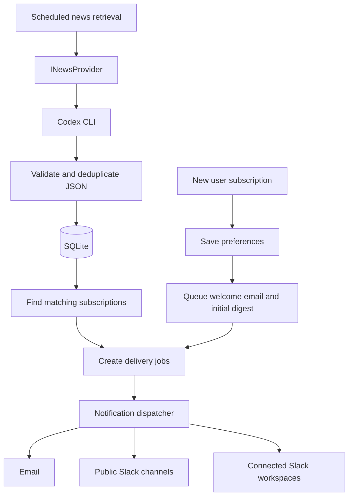
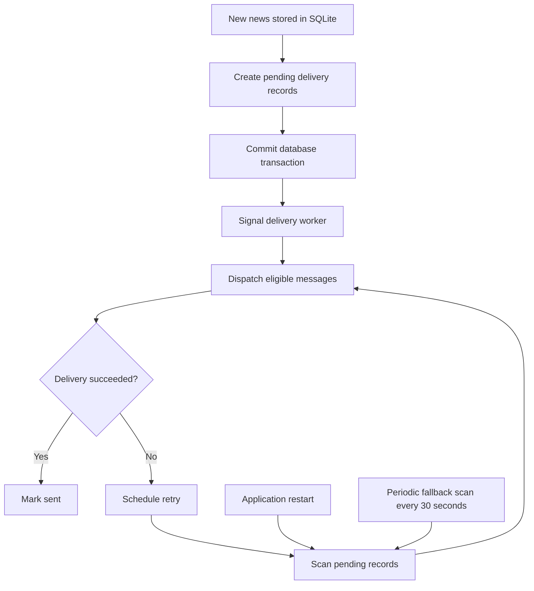

# World News Alerts — Finalized Implementation Plan (v1.1)

Status: Implemented in this repository; setup, configuration and verification are documented in README.md. External integrations require service credentials.

The application will use ASP.NET Core, Angular, SQLite, and Entity Framework Core, with Codex CLI as the initial news retrieval provider and email/Slack as notification channels.

## 1. Confirmed decisions

| Feature                    | Final decision                                              |
| -------------------------- | ----------------------------------------------------------- |
| Slack integration          | Both a public Slack workspace and user-connected workspaces |
| Initial subscription email | Confirmation email and an initial news digest               |
| News notification timing   | Immediately after new qualifying news is stored             |
| News retrieval             | Hourly by default, configurable                             |
| Database                   | SQLite + Entity Framework Core                              |
| Authentication             | ASP.NET Core Identity                                       |
| Email providers            | Resend HTTP API, MailKit SMTP, local development inbox       |
| Background execution       | .NET hosted services                                        |
| Extensibility              | Interfaces for news retrieval and notification delivery     |

### How the main workflow will operate



Important timing distinction: immediate delivery means sending news as soon as the retrieval process discovers and saves it. With hourly retrieval, an event may still be discovered almost an hour after it happens. The retrieval frequency and notification delivery frequency will therefore be configured independently.

## 2. Finalized subscription behavior

### Registration and email verification

A new user registers with their email address and password, verifies the email address, and configures a news subscription.

The subscription includes selected categories, minimum importance, and delivery channels. The time-period options (`6h`, `24h`, `3d`, `7d`) apply to news browsing and the initial digest; they do not delay future breaking-news alerts.

### Initial subscription: both emails

After a verified user creates their first subscription, the backend immediately queues two separate emails:

| Email                     | Content                                                                          |
| ------------------------- | -------------------------------------------------------------------------------- |
| Subscription confirmation | Selected categories, importance, enabled channels and preference-management link |
| Initial news digest       | Matching stored news from the selected lookback period, defaulting to 24 hours   |

The initial digest will not invoke Codex again. It uses the existing database.

Each news item included in the initial digest will be recorded in delivery history to prevent the next background delivery run from sending the same item again to that email destination.

If no matching news exists, send the confirmation and a short digest stating that no qualifying events were found.

For a newly registered account, these emails should be sent after email verification. This prevents sending news notifications to an unverified address.

## 3. Finalized Slack behavior

Both Slack models will be implemented.

Model A — Public workspace

Your application posts news to predefined channels in your own Slack workspace, such as `#breaking-news`, `#geopolitics`, and `#market-movements`.

Anyone invited to the workspace can join the relevant channels. One event is posted at most once per channel and event revision.

Model B — Connected workspaces

A registered user clicks Connect Slack in Angular, completes the Slack OAuth flow, and chooses an authorized destination.

The application stores the workspace connection securely, then sends matching notifications to a chosen channel or linked user's DM.

For personalized notifications, DM delivery is the preferred default. Public channels have common content, whereas DMs can follow individual subscription preferences.

Also, Slack OAuth workspace installation and identification of an individual Slack user are separate concerns. The implementation must securely associate the Angular account with the intended Slack recipient.

Slack's current OAuth v2 installation and `chat.postMessage` APIs support these workflows, subject to scopes and destination permissions.&#x20;

[image](https://www.google.com/s2/favicons?domain=https://docs.slack.dev\&sz=32)

Slack Developer Docs

+1


## 4. Final database refinements

Keep the entity model from the original plan, with these additions.

| Entity                    | Change                                                                                |
| ------------------------- | ------------------------------------------------------------------------------------- |
| `Subscription`            | Add `InitialDigestLookbackHours` and `CreatedAtUtc`                                   |
| `NotificationDestination` | Support email, public Slack channel, external Slack channel, and Slack DM             |
| `SlackWorkspace`          | Add connection owner, workspace ID, installation status and encrypted token reference |
| `DeliveryJob`             | Persist individual pending messages, retry schedule, and message type                 |
| `DeliveryEvent`           | Relate news events to their delivery jobs and destinations                            |
| `NewsEvent`               | Add `Revision` for optional meaningful-update alerts                                  |
| `NewsProviderExecution`   | Record last attempt, success/failure, duration, and event count                       |

### Duplicate-prevention rules

For each event and destination, maintain a unique delivery key:

```
NewsEventId + DestinationId + EventRevision
```

The rules are:

- One email recipient receives an event only once, even when it matches multiple selected categories.
- A Slack channel receives an event only once, even when multiple users subscribe to that same channel.
- Two different Slack channels may each receive the event.
- Initial digest items count toward the recipient's delivery history.
- Failed deliveries are retried from persistent jobs instead of creating new jobs.
- A meaningful revision can be sent again if update notifications are explicitly enabled.

Use SQLite unique indexes to enforce the delivery key, not only an in-memory lookup.

This provides application-level deduplication. Exact once-only external delivery cannot be guaranteed across every network failure—for example, if Slack accepts a message but the application crashes before recording success.

## 5. Immediate-delivery implementation

I recommend a database-backed outbox with an immediate wake-up signal.



The signal can be implemented with `Channel<T>` or a similar in-process mechanism. The database remains the source of truth.

Use a periodic fallback scan, initially every 30 seconds, to recover jobs missed due to crashes or lost signals.

The `NewsRetrievalWorker` uses its configurable interval, initially 60 minutes. The notification worker does not wait for that interval once new jobs have been created.

ASP.NET Core hosted services support these patterns; remember to create a DI scope when using scoped EF Core services inside a `BackgroundService`.&#x20;

[image](https://www.google.com/s2/favicons?domain=https://learn.microsoft.com\&sz=32)

Microsoft Learn


## 6. First implementation tasks

For the first development iteration, I would focus on creating a working foundation and one complete news-subscription flow before integrating real Codex retrieval or Slack OAuth.

## Sprint 1 — Foundation

8 tasks

0/8

1\. Create the solution structure

ASP.NET Core API, Application, Domain, Infrastructure, xUnit tests and Angular frontend.

2\. Configure dependency injection and SQLite

Register DbContext, configure connection string, apply an initial EF Core migration.

3\. Implement ASP.NET Core Identity

User registration, login, logout, email verification and User/Admin roles.

4\. Define domain entities

NewsEvent, NewsSource, Category, Subscription, Destination, DeliveryJob and DeliveryEvent.

5\. Seed supported news categories

All seven categories with stable keys and display names.

6\. Implement news and subscription endpoints

Filtered GET /api/news, create/update subscriptions, authenticated access.

7\. Build Angular authentication and news pages

Login, register, news dashboard and subscription preferences.

8\. Implement FakeNewsProvider and initial tests

Seed example news, validate filtering and test duplicate prevention.

&#x20;Copy Sprint 1 tasks

### Sprint 1 acceptance criteria

At the end of this sprint, you should be able to run the backend and frontend locally, register a user, verify an email address using a development email mechanism, log in, browse seeded news, filter by category/time/importance, and save subscription preferences in SQLite.

You should also have automated tests covering basic news filtering and event deduplication.

Actual email/Slack sending and Codex retrieval are intentionally deferred to the next iterations, so the underlying application is testable independently.

## 7. Bootstrap the projects

From PowerShell on Windows, assuming the .NET 10 SDK, Node.js, and Angular CLI prerequisites are available:

```

mkdir WorldNewsAlerts
cd WorldNewsAlerts

# Backend solution
dotnet new sln -n WorldNewsAlerts

dotnet new webapi -n WorldNewsAlerts.Api -o backend/src/WorldNewsAlerts.Api -f net10.0
dotnet new classlib -n WorldNewsAlerts.Application -o backend/src/WorldNewsAlerts.Application -f net10.0
dotnet new classlib -n WorldNewsAlerts.Domain -o backend/src/WorldNewsAlerts.Domain -f net10.0
dotnet new classlib -n WorldNewsAlerts.Infrastructure -o backend/src/WorldNewsAlerts.Infrastructure -f net10.0

dotnet new xunit -n WorldNewsAlerts.Tests -o backend/tests/WorldNewsAlerts.Tests -f net10.0

# Add all backend projects to the solution
Get-ChildItem backend -Filter *.csproj -Recurse |
    ForEach-Object { dotnet sln add $_.FullName }

# Angular application
npx @angular/cli@latest new frontend --routing --style=scss --standalone --skip-git

git init

```

Next, add project references:

```
dotnet add backend/src/WorldNewsAlerts.Application reference backend/src/WorldNewsAlerts.Domain

dotnet add backend/src/WorldNewsAlerts.Infrastructure reference backend/src/WorldNewsAlerts.Application

dotnet add backend/src/WorldNewsAlerts.Api reference backend/src/WorldNewsAlerts.Application

dotnet add backend/src/WorldNewsAlerts.Api reference backend/src/WorldNewsAlerts.Infrastructure
```

Then install EF Core and Identity persistence packages:

```
$infra = "backend/src/WorldNewsAlerts.Infrastructure"

dotnet add $infra package Microsoft.EntityFrameworkCore.Sqlite
dotnet add $infra package Microsoft.AspNetCore.Identity.EntityFrameworkCore
dotnet add $infra package Microsoft.EntityFrameworkCore.Design
```

Configure the dependency injection registrations and Identity database context before creating the first migration. Keep the EF Core package major versions aligned with the .NET target.

For local development, I suggest proxying Angular's `/api` requests to the ASP.NET Core backend. This simplifies same-origin authentication and avoids unnecessary cross-origin cookie complexity.

## 8. Tasks after Sprint 1

| Sprint                  | Implementation                                                               | Completion milestone                                     |
| ----------------------- | ---------------------------------------------------------------------------- | -------------------------------------------------------- |
| 2 — News ingestion      | `INewsProvider`, Codex CLI adapter, JSON Schema validation, retrieval worker | Real news stored automatically                           |
| 3 — Email notifications | SMTP, two initial emails, templates, outbox and dispatcher                   | Subscribers receive emails immediately after eligibility |
| 4 — Public Slack        | App installation, predefined channels, destination-based deduplication       | News automatically posted to your public workspace       |
| 5 — Slack OAuth         | External workspace connection, member linking, destination selection         | Users can connect their own workspaces                   |
| 6 — Admin and polish    | User/provider/channel administration, job monitoring, retries and tests      | Complete coursework-ready application                    |

For Sprint 2, the Codex provider must embed the expected JSON structure in its generated query, as specified in the original plan, and also enforce that contract with `--output-schema`.

The documented noninteractive CLI supports `codex exec`, schema-constrained output, and saving the final response to a file.&#x20;

[image](https://www.google.com/s2/favicons?domain=https://developers.openai.com\&sz=32)

OpenAI Developers

&#x20;The provider should deserialize that final response, not the JSONL execution log.


## 9. Ready-to-use Codex prompt for Sprint 1

Since you're already using Codex, you can give it the following implementation task in your repository. It deliberately limits the scope to Sprint 1.

```

Implement Sprint 1 of the WorldNewsAlerts application.

Technology:
- .NET 10 ASP.NET Core Web API
- Angular with standalone components
- SQLite and Entity Framework Core
- ASP.NET Core Identity
- xUnit

Architecture:
- WorldNewsAlerts.Api
- WorldNewsAlerts.Application
- WorldNewsAlerts.Domain
- WorldNewsAlerts.Infrastructure
- WorldNewsAlerts.Tests
- Angular frontend

Requirements:

1. Create the backend solution and Angular project.
2. Implement dependency injection and EF Core SQLite.
3. Configure ASP.NET Core Identity with User and Admin roles.
4. Add registration, email verification, login and logout.
5. Use secure HttpOnly authentication cookies.
6. Define these domain entities:
   NewsEvent, NewsSource, NewsEventCategory,
   Subscription, SubscriptionCategory,
   NotificationDestination, SubscriptionDestination,
   SlackWorkspace, DeliveryJob, DeliveryEvent.
7. Seed seven news categories:
   breaking_news, market_movements,
   natural_disasters, geopolitics,
   technology_ai, economy, health.
8. Support two importance levels:
   exceptional and significant.
9. Implement GET /api/news with category,
   importance, time-period and pagination filters.
10. Implement authenticated subscription CRUD endpoints.
11. Implement Angular registration, login, news dashboard,
    filtering and subscription settings.
12. Create a FakeNewsProvider with sample events.
13. Implement duplicate event detection and
    unique database indexes.
14. Add unit and integration tests for key use cases.

Design for future components:
- INewsProvider, including Codex CLI and future Grok providers.
- INotificationChannel, including Email and Slack.
- Hourly configurable news retrieval.
- Immediate database-backed notification dispatch.
- Email confirmation and initial digest.
- Public Slack workspace and external Slack OAuth.

Do not implement external Codex, SMTP, or Slack integrations
in this sprint. Define their contracts only.

Use cancellation tokens for asynchronous operations.
Use EF Core migrations, proper DI lifetimes,
logging, validation and centralized exception handling.

Do not hardcode passwords, tokens or API keys.

The solution must build successfully.
Run the available tests and fix failures.
Document setup instructions in README.md.

```

You can place this in `sprint1-prompt.txt` and run:

```
Get-Content sprint1-prompt.txt -Raw |
    codex exec - --sandbox workspace-write
```

That allows Codex to implement the first sprint directly in the repository, subject to its configured permissions.

Final scope: this will be a modular monolith with a reusable retrieval pipeline, persistent notification queue, two delivery channels and an Angular administration interface. The important foundation is to implement subscription matching and delivery deduplication independently of the external providers, so adding Grok, Telegram, push notifications, or additional news sources later requires adapters rather than a redesign.
