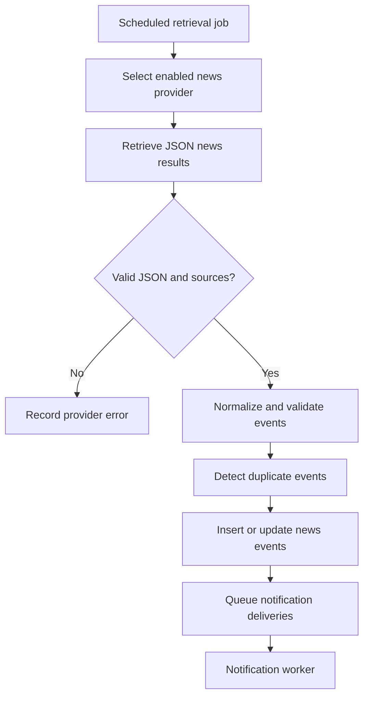
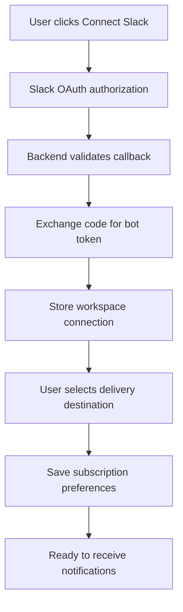
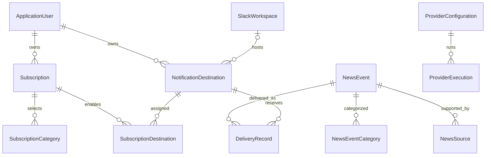

# World News Alert System — Development Plan

ASP.NET Core + Angular + SQLite + Codex CLI + Email + Slack

## 1. Project overview

Build a full-stack application that retrieves significant worldwide news, stores and categorizes events, and notifies subscribed users through their preferred communication channels.

The application will have three main areas:

- News dashboard: Browse, search, and filter important world events.
- User subscriptions: Register, select news categories, configure notification preferences, and connect delivery channels.
- Administration: Manage users, news providers, delivery integrations, background jobs, and system settings.

### Recommended technology stack

| Component             | Technology                                   |
| --------------------- | -------------------------------------------- |
| Backend               | ASP.NET Core 10 Web API, C#                  |
| Frontend              | Angular, TypeScript, standalone components   |
| Database              | SQLite                                       |
| ORM                   | Entity Framework Core                        |
| Authentication        | ASP.NET Core Identity                        |
| News retrieval        | Codex CLI, through `INewsProvider`           |
| Email                 | Resend HTTP API or SMTP through MailKit      |
| Slack                 | Slack Web API and OAuth 2.0                  |
| Background processing | .NET `BackgroundService`                     |
| Logging               | Serilog                                      |
| API documentation     | OpenAPI                                      |
| Testing               | xUnit, integration tests, Angular unit tests |

For a coursework application, I recommend a modular monolith, not microservices. One ASP.NET Core application can host the API and background workers, while Angular runs as a separate frontend.

That keeps deployment and debugging simple without sacrificing a clean architecture.

## 2. High-level architecture

Angular frontend

News dashboard · Subscriptions · Admin panel

ASP.NET Core Web API

Authentication · Authorization · Business logic

News retrieval

INewsProvider

Codex CLI, future Grok/API adapters

News delivery

INotificationChannel

Email, Slack, future channels

SQLite + Entity Framework Core

Users · Events · Preferences · Destinations · Delivery history

Retrieval and notification dispatch run in hosted background services, independently from incoming HTTP requests.

### Important architectural decisions

A. Retrieve news globally, not individually for every user.

The background worker retrieves news once and saves it. Users browse and subscribe to that shared dataset. This avoids executing Codex separately for each subscriber.

B. Separate news retrieval from delivery.

Retrieval produces normalized events. Notification delivery determines which subscribers and destinations should receive each event.

C. Separate filtering from notification scheduling.

The options Last 6 hours, Last 24 hours, Last 3 days, and Last 7 days control the news dashboard. They should not cause old news to be repeatedly emailed to users.

D. Support two Slack subscription models.

Users may either join your own public Slack workspace or connect an external Slack workspace via OAuth. These are different workflows, but both can use the same Slack delivery implementation.

E. Use persistent delivery records.

Every individual email or Slack message is tracked in the database so recurring jobs can identify already processed notifications.

## 3. Functional requirements

### 3.1 User registration and authentication

Users can:

- Register with email and password.
- Verify their email address.
- Log in and log out.
- Reset their password.
- Update their profile and notification preferences.
- Unsubscribe from individual categories or all notifications.
- Delete their account.

Use ASP.NET Core Identity with two roles: `User` and `Admin`.

For an Angular application, I recommend secure HttpOnly authentication cookies when frontend and backend are deployed under the same site. The API must also enforce CSRF protection for state-changing requests.

### 3.2 News categories, periods and importance

Define categories centrally as stable identifiers rather than using display text in the database.

| Code                | Display name      |
| ------------------- | ----------------- |
| `breaking_news`     | Breaking news     |
| `market_movements`  | Market movements  |
| `natural_disasters` | Natural disasters |
| `geopolitics`       | Geopolitics       |
| `technology_ai`     | Technology & AI   |
| `economy`           | Economy           |
| `health`            | Health            |

An event may belong to multiple categories. For example, a major earthquake that disrupts financial markets could belong to both `natural_disasters` and `market_movements`.

For importance, use two values:

- `exceptional`: Events of exceptional international importance.
- `significant`: Other internationally significant events.

A subscriber choosing All significant events receives both levels.

For time periods, support `6h`, `24h`, `3d`, and `7d`. The selected window is evaluated relative to the current UTC time.

### 3.3 User-facing screens

News dashboard

Illustrative Angular layout

Mockup

Categories

Breaking news

Market movements

Natural disasters

Geopolitics

Technology & AI

Economy

Health

Time period

6h24h3 days7 days

Importance

Exceptional only

All significant events

News feed

Example data

Geopolitics · Breaking news

Exceptional

International diplomatic talks announced

Sample event summary with verified sources, location and event timestamp.

2 independent sources · UTC timestamp

The controls demonstrate the filter design only. They do not query a backend.

The actual Angular application should have the following routes:

| Route                 | Purpose                             |
| --------------------- | ----------------------------------- |
| `/login`              | Authentication                      |
| `/register`           | New account                         |
| `/news`               | News feed and filters               |
| `/news/:id`           | Event details and sources           |
| `/subscriptions`      | Categories, importance and channels |
| `/settings`           | Profile and email preferences       |
| `/integrations/slack` | Slack connection management         |
| `/notifications`      | Notification history                |
| `/admin`              | Admin dashboard                     |
| `/admin/users`        | User management                     |
| `/admin/providers`    | News provider configuration         |
| `/admin/channels`     | Delivery channel configuration      |
| `/admin/jobs`         | Job history and manual execution    |

## 4. News retrieval design

### Interface-based provider abstraction

Define the provider contract in the Application layer.

```
public interface INewsProvider
{
    string ProviderKey { get; }

    Task<NewsFetchResult> FetchAsync(
        NewsFetchRequest request,
        CancellationToken cancellationToken);
}

public record NewsFetchRequest(
    DateTimeOffset FromUtc,
    DateTimeOffset ToUtc,
    IReadOnlyCollection<string> Categories);

public record NewsFetchResult(
    string ProviderKey,
    DateTimeOffset RetrievedAtUtc,
    IReadOnlyList<RetrievedNewsEvent> Events);
```

Implement the following provider:

```
public sealed class CodexNewsProvider : INewsProvider
{
    public string ProviderKey => "codex";

    // Calls the Codex CLI, validates its output,
    // and returns normalized news events.
}
```

Future implementations could include:

```
INewsProvider
    ├── CodexNewsProvider
    ├── GrokNewsProvider
    ├── OpenAiNewsProvider
    └── RssNewsProvider
```

The provider selection should be configurable through the administration panel. The first version should support one active provider, with the architecture allowing multiple providers later.

### Retrieval pipeline



The system should:

1. Retrieve events in overlapping time windows to avoid missing delayed publications.
2. Validate required fields and check that source URLs are structurally valid.
3. Distinguish `eventTimeUtc` from `publishedAtUtc` and `retrievedAtUtc`.
4. Classify events into one or more categories.
5. Detect duplicate events from different providers or sources.
6. Preserve source information and timestamps.
7. Reject unsupported or unverifiable events rather than inventing missing details.
8. Save provider execution metrics and failures.

Important: Codex is an AI agent, not a dedicated breaking-news feed. Successful execution does not prove that its news information is current. The host running it must have working search/network access, and source verification is necessary.

## 5. Codex CLI provider implementation

This is a required part of the first version.

The application starts a child process, executes `codex exec`, and reads the JSON result.

### Command

```
codex exec --skip-git-repo-check `
    --output-schema news-schema.json `
    --output-last-message news-result.json `
    "YOUR NEWS QUERY WITH EXPLICIT JSON CONTRACT"
```

The CLI supports `--output-schema` for structured final responses and `--output-last-message` for saving the final answer to a file. Its `--json` flag is different: that produces an execution-event JSONL stream, not simply the news result.&#x20;

[image](https://www.google.com/s2/favicons?domain=https://github.com\&sz=32)

GitHub

+1


For longer dynamically generated prompts, pass the prompt through standard input instead of command-line quoting.

### Required Codex query template

The query should be constructed using the configured date range, categories, and output contract.

```

Search reliable, current public news sources for major
world events between {fromUtc} and {toUtc}.

Categories:
breaking_news, market_movements, natural_disasters,
geopolitics, technology_ai, economy, health.

Requirements:
- Report only internationally significant events.
- Use actual web search results, not model memory.
- Do not fabricate news, timestamps, or source URLs.
- Include only verified, source-backed information.
- Use multiple independent reliable sources where available.
- Do not include the same event more than once.
- Treat articles describing one event as one event.
- Use UTC timestamps in ISO 8601 format.
- Use null if an event timestamp is unknown.
- Return an empty events array if no qualifying events exist.
- Return ONLY a valid JSON object; no markdown.

Return exactly this JSON structure:

{
  "retrievedAtUtc": "ISO-8601 UTC timestamp",
  "events": [
    {
      "title": "string",
      "summary": "string",
      "categories": [
        "breaking_news"
      ],
      "importance": "exceptional",
      "location": "string or null",
      "eventTimeUtc": "ISO-8601 UTC timestamp or null",
      "sources": [
        {
          "publisher": "string",
          "url": "https://...",
          "publishedAtUtc": "ISO-8601 UTC timestamp or null"
        }
      ]
    }
  ]
}

Allowed importance values:
exceptional, significant.

Allowed categories:
breaking_news, market_movements, natural_disasters,
geopolitics, technology_ai, economy, health.

```

This contract should also be enforced with a matching JSON Schema file. The example above is the structure embedded in the prompt, as requested; production code should not use the example strings as actual data.

The application should never trust the returned JSON without validation.

### Execution requirements

The `CodexNewsProvider` should:

- Use `ProcessStartInfo.ArgumentList`, not dynamically constructed shell commands.
- Use a dedicated working directory with minimal permissions.
- Set process timeouts and support cancellation.
- Capture the exit code, output, and standard error.
- Deserialize the final JSON into strongly typed DTOs.
- Validate JSON Schema and business rules.
- Prevent overlapping Codex executions.
- Log failures without exposing authentication secrets.
- Avoid arbitrary command execution, unnecessary filesystem permissions, and user-generated shell arguments.

Use noninteractive Codex authentication suitable for the execution environment and verify that unattended hourly operation works with the available usage limits.

## 6. Notification delivery architecture

Create a separate interface for notification channels.

```
public interface INotificationChannel
{
    string ChannelKey { get; }

    Task<DeliveryResult> SendAsync(
        NotificationMessage message,
        NotificationDestination destination,
        CancellationToken cancellationToken);
}
```

Implement:

```
INotificationChannel
    ├── EmailNotificationChannel
    ├── SlackNotificationChannel
    ├── TelegramNotificationChannel  (future)
    ├── PushNotificationChannel      (future)
    └── WebhookNotificationChannel   (future)
```

Use a `NotificationDispatcher` service to select the appropriate implementation. The retrieval provider should know nothing about Slack or email.

The notification pipeline should use database-persisted delivery jobs rather than relying only on an in-memory queue. This protects pending notifications from being lost if the application restarts.

### 6.1 Email notifications

Implement an `EmailNotificationChannel` with interchangeable `IEmailProvider` adapters: SMTP through MailKit, Resend through its HTTP API, and a local development inbox. Select the active provider in administration. Resend credentials use `Email__Resend__ApiKey`, with `Email__FromAddress` for an authorized sender. Both providers share templates and persistent delivery jobs; Resend requests use the job ID as an idempotency key.

The application should support a predefined HTML email template and a plain-text alternative.

Example news notification

WORLD NEWS ALERTS

Important international development

A major event has been reported and verified by multiple news sources.

Geopolitics

Exceptional

Location: Europe

Sources: Reuters · Associated Press

Manage preferences · Unsubscribe

Illustrative HTML email layout.

Template placeholders:

```
{{UserName}}
{{NewsTitle}}
{{Summary}}
{{Categories}}
{{Importance}}
{{Location}}
{{EventTime}}
{{SourceLinks}}
{{UnsubscribeUrl}}
```

Use HTML escaping for dynamic text, keep source links clickable, and provide a secure unsubscribe link.

An email address must be verified before ordinary news notifications are activated.

### 6.2 Immediate email after subscription

When a user creates a subscription:

1. Validate the subscription preferences.
2. Save the subscription to SQLite.
3. Create an immediate email delivery job in the same database transaction.
4. Wake the notification worker immediately.
5. Send the email without waiting for the next hourly news retrieval.
6. Save the delivery outcome.

I recommend the initial email contain a subscription confirmation and optional initial news digest. The initial digest should use news already stored in the database rather than triggering a separate Codex execution.

If SMTP fails, preserve the subscription and retry the pending email job.

## 7. Slack integration

I recommend supporting both workspace models through a common `SlackNotificationChannel`.

### Model A — Your own public Slack workspace

This should be implemented first because it is much simpler.

Create a workspace such as `World News Alerts` and channels for each news category.

Users can join the workspace through a published invitation link, then join their preferred channels.

For example:

| Slack channel        | Filter            |
| -------------------- | ----------------- |
| `#breaking-news`     | Breaking news     |
| `#market-movements`  | Market movements  |
| `#natural-disasters` | Natural disasters |
| `#geopolitics`       | Geopolitics       |
| `#technology-ai`     | Technology & AI   |
| `#economy`           | Economy           |
| `#health`            | Health            |

You could also offer `#exceptional-events`, containing only the highest-priority events across all categories.

The application posts messages once per relevant channel. Slack handles delivery and notification settings for members.

Important distinction: a shared Slack channel has one common feed. It cannot deliver different importance filters to individual members. For personalized Slack preferences, use bot direct messages instead. Also, joining a Slack workspace does not automatically link a Slack member to their account in your Angular application.

### Model B — Connect an external Slack workspace

A registered user can select Connect Slack Workspace from the Angular interface.



Each installation needs its own workspace identity and access token. Validate the OAuth `state` parameter, protect tokens, and provide a way to disconnect or revoke the integration. Slack documents this through its OAuth v2 installation process.&#x20;

[image](https://www.google.com/s2/favicons?domain=https://docs.slack.dev\&sz=32)

Slack Developer Docs


For Slack delivery, use `chat.postMessage` with the `chat:write` scope, adding channel-discovery permissions only when necessary. The bot must be authorized to post to the selected destination.&#x20;

[image](https://www.google.com/s2/favicons?domain=https://docs.slack.dev\&sz=32)

Slack Developer Docs

+1


The OAuth installation identifies the workspace, but personalized direct-message delivery also requires a reliable association between the registered application's user and the correct Slack member.

### Slack subscription data

A Slack destination should include:

```
SlackWorkspaceId
SlackChannelId or SlackUserId
DestinationType (Channel / DirectMessage)
IsActive
```

Keep Slack workspace tokens separately from user-visible destination details.

For a coursework MVP, support your own workspace and predefined channels first. Add arbitrary-workspace OAuth after the basic news notification flow is working.

## 8. Database design — SQLite + EF Core

Use ASP.NET Core Identity's standard tables for account management and add the following domain entities.

| Entity                    | Important fields                                                                   | Responsibility                          |
| ------------------------- | ---------------------------------------------------------------------------------- | --------------------------------------- |
| `NewsEvent`               | Id, Title, Summary, Importance, EventTimeUtc, RetrievedAtUtc, EventFingerprint     | Canonical news event                    |
| `NewsEventCategory`       | NewsEventId, CategoryId                                                            | Many-to-many categorization             |
| `NewsSource`              | Id, NewsEventId, Publisher, Url, PublishedAtUtc                                    | Evidence and source information         |
| `Subscription`            | Id, UserId, MinimumImportance, IsActive, CreatedAtUtc                              | User preferences                        |
| `SubscriptionCategory`    | SubscriptionId, CategoryId                                                         | Selected categories                     |
| `NotificationDestination` | Id, UserId, ChannelType, TargetIdentifier, IsActive                                | Email address, Slack DM or channel      |
| `SubscriptionDestination` | SubscriptionId, DestinationId                                                      | Enabled delivery channels               |
| `SlackWorkspace`          | Id, TeamId, Name, TokenSecretReference, IsActive                                   | Installed workspaces                    |
| `DeliveryRecord`          | Id, NewsEventId, DestinationId, Status, AttemptCount, SentAtUtc, ExternalMessageId | Delivery tracking                       |
| `ProviderConfiguration`   | Id, ProviderKey, IsEnabled, SettingsJson                                           | Retrieval providers                     |
| `ProviderExecution`       | Id, ProviderKey, StartedAtUtc, CompletedAtUtc, Status, EventsCount, Error          | Execution history                       |
| `SystemSetting`           | Key, Value                                                                         | Configurable job intervals and settings |

Identity's tables are additional to this list.

`NewsEvent` should also have optional update/revision fields if you want to notify users about meaningful changes to an existing story.

### Database relationships



### 8.1 Preventing duplicate news events

Different retrieval runs may return the same news in different wording.

Use two levels of deduplication:

Exact source matching: Normalize source URLs and identify already stored articles. Add a unique index on the normalized URL.

Canonical event matching: Compare events using normalized titles, event dates, locations, and existing source relationships. Assign one canonical `NewsEvent.Id` to multiple articles describing the same event.

The application should generate its own event identity. Do not trust AI-generated IDs to remain stable between runs.

### 8.2 Preventing duplicate notifications

Use the `DeliveryRecord` table as a persistent delivery ledger.

Possible statuses:

```
Pending
Processing
Sent
Failed
RetryScheduled
Cancelled
```

Before sending a message, create or claim a delivery record using a database uniqueness constraint.

For the initial implementation, use a unique index on:

```
(NewsEventId, DestinationId, EventRevision)
```

For ordinary events, `EventRevision` can initially be `1`.

This prevents your application from intentionally queuing the same event twice for the same destination.

For Slack, `DestinationId` identifies the actual workspace channel or direct-message destination, not merely the user subscription.

That distinction is essential: when five users subscribe to the same public Slack channel, the event should be posted once, not five times.

For email, each verified recipient has their own email destination and corresponding delivery record.

There is one limitation: a database transaction cannot atomically commit an email or Slack API response. If delivery succeeds but the process crashes before recording success, a retry could duplicate the external message. The design should minimize this with durable states and cautious handling of uncertain outcomes, rather than claiming guaranteed exactly-once delivery.

### 8.3 SQLite configuration

Enable WAL mode and configure a suitable busy timeout. Keep write transactions short, particularly when generating many notification jobs.

SQLite supports simultaneous readers and a single writer at a time; WAL improves read/write concurrency but does not allow multiple simultaneous writers.&#x20;

[image](https://www.google.com/s2/favicons?domain=https://www.sqlite.org\&sz=32)

sqlite.org


For this coursework application, the recommended deployment is a single backend instance with a persistent local SQLite database file.

## 9. Background job design

Use two independently scheduled background services, plus an immediate-delivery signal.

| Job                          | Default execution         | Purpose                                    |
| ---------------------------- | ------------------------- | ------------------------------------------ |
| `NewsRetrievalWorker`        | Every 60 minutes          | Retrieve and store news                    |
| `NotificationDeliveryWorker` | Every 30 seconds          | Send pending notifications                 |
| Immediate notification       | Triggered on subscription | Send subscription confirmation immediately |
| Delivery retry               | Configurable backoff      | Retry temporary delivery failures          |

The intervals should be configurable using `IOptionsMonitor<T>` or database-backed settings that are reloaded by the worker.

Example configuration:

```
{
  "NewsRetrieval": {
    "Enabled": true,
    "IntervalMinutes": 60,
    "LookbackMinutes": 120,
    "Provider": "codex",
    "TimeoutSeconds": 180
  },
  "Notifications": {
    "Enabled": true,
    "PollingIntervalSeconds": 30,
    "MaximumRetryCount": 3,
    "InitialRetryDelaySeconds": 60
  }
}
```

The implementation should use `PeriodicTimer` or another cancellation-aware mechanism, prevent overlapping retrieval executions, and create a DI scope for EF Core operations.

Microsoft recommends resolving scoped services through a scope in a `BackgroundService`, rather than injecting a scoped `DbContext` into the singleton hosted service.&#x20;

[image](https://www.google.com/s2/favicons?domain=https://learn.microsoft.com\&sz=32)

Microsoft Learn

+1


For a single-instance SQLite application, this is sufficient without introducing Hangfire, Redis, or a separate messaging broker.

## 10. Backend API endpoints

Define versioned REST endpoints.

| Method | Endpoint                         | Purpose                     |
| ------ | -------------------------------- | --------------------------- |
| POST   | `/api/auth/register`             | Register user               |
| POST   | `/api/auth/login`                | Authenticate                |
| POST   | `/api/auth/logout`               | Log out                     |
| GET    | `/api/news`                      | Retrieve filtered news      |
| GET    | `/api/news/{id}`                 | News event details          |
| GET    | `/api/subscriptions`             | Get user subscriptions      |
| PUT    | `/api/subscriptions`             | Update preferences          |
| POST   | `/api/subscriptions`             | Create subscription         |
| DELETE | `/api/subscriptions/{id}`        | Unsubscribe                 |
| GET    | `/api/notification-destinations` | List connected channels     |
| POST   | `/api/slack/connect`             | Start Slack OAuth           |
| GET    | `/api/slack/callback`            | Handle Slack authorization  |
| DELETE | `/api/slack/connections/{id}`    | Disconnect Slack            |
| GET    | `/api/notifications`             | User's delivery history     |
| GET    | `/api/admin/users`               | Manage users                |
| GET    | `/api/admin/providers`           | List news providers         |
| PUT    | `/api/admin/providers/{id}`      | Configure provider          |
| GET    | `/api/admin/channels`            | Supported delivery channels |
| GET    | `/api/admin/jobs`                | Job executions              |
| POST   | `/api/admin/jobs/retrieve-news`  | Manually trigger retrieval  |

For example, retrieving news:

```
GET /api/news?categories=geopolitics,market_movements&period=24h&importance=exceptional&page=1&pageSize=20
```

Return paginated responses. Use server-side validation, authorization policies, cancellation tokens, and consistent error handling with `ProblemDetails`.

## 11. Angular project structure

Use Angular standalone components with lazy-loaded routes and Signals for component state. Angular supports standalone components and fine-grained reactive state through Signals.&#x20;

[image](https://www.google.com/s2/favicons?domain=https://angular.dev\&sz=32)

angular.dev

+1


Suggested structure:

```

frontend/
└── src/
    └── app/
        ├── core/
        │   ├── auth/
        │   ├── guards/
        │   ├── interceptors/
        │   └── services/
        ├── shared/
        │   ├── components/
        │   ├── models/
        │   └── utilities/
        ├── features/
        │   ├── news/
        │   │   ├── news-list/
        │   │   ├── news-detail/
        │   │   └── news-filters/
        │   ├── subscriptions/
        │   ├── notifications/
        │   ├── slack-integration/
        │   ├── profile/
        │   └── admin/
        │       ├── users/
        │       ├── providers/
        │       ├── delivery-channels/
        │       └── background-jobs/
        ├── app.routes.ts
        └── app.config.ts

```

Use reactive forms for subscription configuration and account registration.

The Angular application should retrieve available news providers and delivery channels from the backend rather than hardcoding provider capabilities.

## 12. Backend solution structure

```

backend/
├── WorldNewsAlerts.sln
├── src/
│   ├── WorldNewsAlerts.Api/
│   │   ├── Controllers/
│   │   ├── Middleware/
│   │   ├── Authorization/
│   │   └── Program.cs
│   ├── WorldNewsAlerts.Application/
│   │   ├── Interfaces/
│   │   ├── Services/
│   │   ├── DTOs/
│   │   └── Validators/
│   ├── WorldNewsAlerts.Domain/
│   │   ├── Entities/
│   │   ├── Enums/
│   │   └── ValueObjects/
│   └── WorldNewsAlerts.Infrastructure/
│       ├── Persistence/
│       ├── NewsProviders/
│       │   └── CodexNewsProvider.cs
│       ├── NotificationChannels/
│       │   ├── EmailNotificationChannel.cs
│       │   └── SlackNotificationChannel.cs
│       ├── BackgroundJobs/
│       └── Templates/
└── tests/
    ├── WorldNewsAlerts.UnitTests/
    └── WorldNewsAlerts.IntegrationTests/

```

This provides a clean separation between domain models, application contracts, external integrations and API endpoints.

## 13. Administration panel

The admin panel should expose three main management areas.

User management

View registered users, roles, email verification status, active subscriptions, selected categories and notification destinations. Enable/disable accounts and inspect delivery failures.

News provider management

View Codex and future providers, enable or disable them, select the active provider, adjust retrieval intervals, see execution history, error messages, and last successful retrieval.

Delivery channel management

Inspect supported channels, enable or disable email/Slack delivery, test administrator-controlled destinations, and monitor sent, pending and failed messages.

Do not expose provider API keys, Slack OAuth tokens, or SMTP passwords in the admin UI. Store secrets securely through environment configuration or a secret manager.

## 14. Testing and reliability

These are the most important automated test scenarios for the project.

| Test                                               | Expected result                                    |
| -------------------------------------------------- | -------------------------------------------------- |
| Unverified user subscribes                         | No ordinary news emails until verification         |
| Two retrieval runs return the same event           | One canonical event                                |
| Two providers return articles about the same event | Articles linked to one event                       |
| User subscribes to two matching categories         | One email per event                                |
| Multiple users select the same Slack channel       | One Slack post to that channel                     |
| Slack and email both enabled                       | Both destinations receive one delivery             |
| Slack API temporarily fails                        | Retry without creating another pending delivery    |
| Codex returns invalid JSON                         | Provider failure logged; no bad events persisted   |
| Codex returns an empty event array                 | Successful empty retrieval                         |
| New subscription created                           | Immediate confirmation email queued and dispatched |
| Background worker restarts                         | Pending deliveries remain available                |
| Ordinary user requests admin endpoint              | Access denied                                      |

For testing, implement a `FakeNewsProvider` returning a predefined set of events and fake notification channels that record calls without sending external messages.

This makes the entire pipeline testable without consuming Codex usage or sending real Slack notifications.

## 15. Implementation roadmap

I would implement the application in the following order.

Implementation checklist

0/24 completed

Phase 1 — Foundation

Create .NET solution and Angular project

Configure SQLite, EF Core migrations and Identity

Implement registration, authentication and roles

Create database entities and initial seed data

Phase 2 — News retrieval

Define INewsProvider and DTOs

Implement FakeNewsProvider for development

Implement CodexNewsProvider and JSON Schema validation

Create retrieval worker and event deduplication

Implement news API and Angular dashboard

Phase 3 — Subscriptions and email

Create subscription preferences UI and endpoints

Define INotificationChannel

Implement email templates and SMTP delivery

Create persistent delivery records and worker

Implement immediate welcome email and notification history

Phase 4 — Slack

Configure public Slack workspace and channels

Implement SlackNotificationChannel

Persist Slack destinations and message IDs

Implement Slack connection UI and category subscriptions

Add multi-workspace OAuth support

Phase 5 — Administration and quality

Implement admin user, provider and channel pages

Implement job history and manual retrieval

Add integration tests for deduplication and retries

Validate authorization and error handling

Prepare deployment configuration and project documentation

&#x20;Copy checklist

The minimum working version should be complete at the end of Phase 3: users can register, filter news, subscribe, and receive email notifications from automatically retrieved news.

Slack integration and administration can then be added without redesigning the retrieval or delivery layers.

## 16. Deployment and configuration

For the coursework version, deploy as one ASP.NET Core process, an Angular frontend, and a persistent SQLite file.

Required environment configuration:

```
ConnectionStrings__DefaultConnection
NewsRetrieval__IntervalMinutes
NewsRetrieval__Provider
Slack__ClientId
Slack__ClientSecret
Slack__SigningSecret
Slack__BotToken
Email__SmtpHost
Email__SmtpUsername
Email__SmtpPassword
Email__FromAddress
```

Use environment variables or development secrets. Avoid including actual credentials in `appsettings.json` or the Git repository.

If the application is hosted publicly, configure HTTPS, persistent database storage, SMTP access, the Slack OAuth callback URL, and a policy for backups.

## 17. Decisions to confirm before implementation

I have made reasonable default assumptions so development can begin, but these three decisions affect the final behavior.

1\. Slack delivery model

Both public workspace and personalized Slack subscriptions (recommended)

Only my public workspace for now

Users connect their own Slack workspaces

2\. Initial email after subscription

Subscription confirmation (recommended)

Immediate digest of matching news already in the database

Confirmation and initial news digest

3\. Regular news delivery

As soon as new qualifying news is stored (recommended)

Periodic digest emails

Support both immediate alerts and digests

Confirm design decisions&#x20;

Overall recommendation: use SQLite, one ASP.NET Core application with hosted workers, a modular Angular frontend, Codex CLI as the initial retrieval provider, and a database-backed notification dispatcher. This is a manageable coursework project that still demonstrates dependency injection, background processing, EF Core, authentication, third-party integrations, and extensible software architecture.
